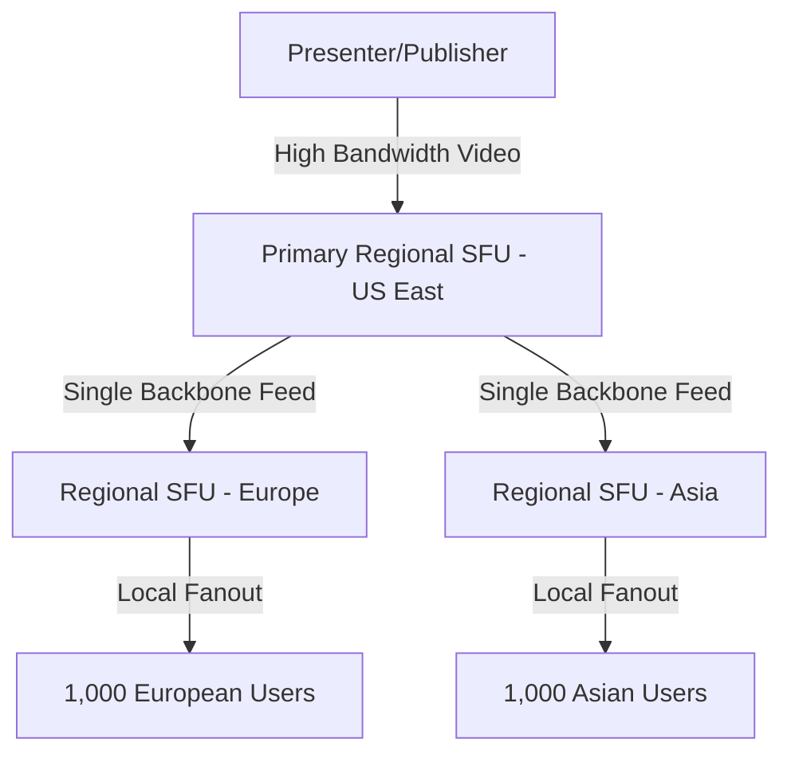

# Enterprise-Scale WebRTC Logic (Competing with Zoom, Teams, & Meet)

To match the performance, scale, and video quality of enterprise platforms like Zoom, Microsoft Teams, and Google Meet, you need to implement five core engineering logics.

---

## 1. Selective Video Forwarding & Client Grid Optimization
In Zoom or Teams, when you have 49 people on screen, your computer doesn't decode 49 full-HD videos. 

### The Logic
*   **Simulcast & SVC (Scalable Video Coding):** The presenter's browser publishes three quality layers (Low, Medium, High). 
*   **Viewport-Aware Subscriptions:** The client-side React code informs the SFU of the actual size of the video element on screen. If a participant's video card is tiny (e.g., $150\times100$ pixels in a grid), the server only forwards the **Low** quality stream. If the user double-clicks to focus/pin a speaker, the client requests the **High** quality stream.
*   **Off-screen Track Muting:** If a participant scroll pages in the grid, the client must automatically pause/unsubscribe from the video tracks of participants who are no longer visible.

---

## 2. Selective Audio Forwarding (Active Speaker Detection)
If 100 people are in a meeting, decoding 100 audio tracks simultaneously will saturate client CPU and create background hiss.

### The Logic
*   **Active Speaker Ranking:** The SFU constantly calculates the audio volume (DB levels) of all participants.
*   **Audio Gatekeeping:** The SFU only mixes and forwards the audio tracks of the **top 3 to 5 active speakers** at any given millisecond. The other 95+ tracks are muted at the server level, eliminating decoding overhead.

---

## 3. Cascading SFUs (Hierarchical Routing)
For large-scale webinars or interactive events crossing continents, a single media server node cannot distribute the bandwidth.

### The Logic
*   Instead of having 2,000 clients connect directly to the presenter's server, the media stream is routed across a tree of servers. 
*   The presenter streams to their local ingest node. That node forwards **one copy** of the stream to regional edge servers over a dedicated high-speed cloud backbone. The edge servers then distribute the stream to local clients, reducing latency and preventing ingress bottlenecks.

---

## 4. Geo-Routing & Anycast Ingress
Zoom and Teams route users to the closest data center to ensure the lowest possible Round Trip Time (RTT).

### The Logic
*   **Anycast IP Routing:** Route users to the nearest network edge server using Anycast routing.
*   **Dynamic TURN Allocation:** The control plane inspects the client's IP location and mints TURN/STUN credentials specifically pointing to the closest regional coturn node, preventing media packet transit delays across oceans.
