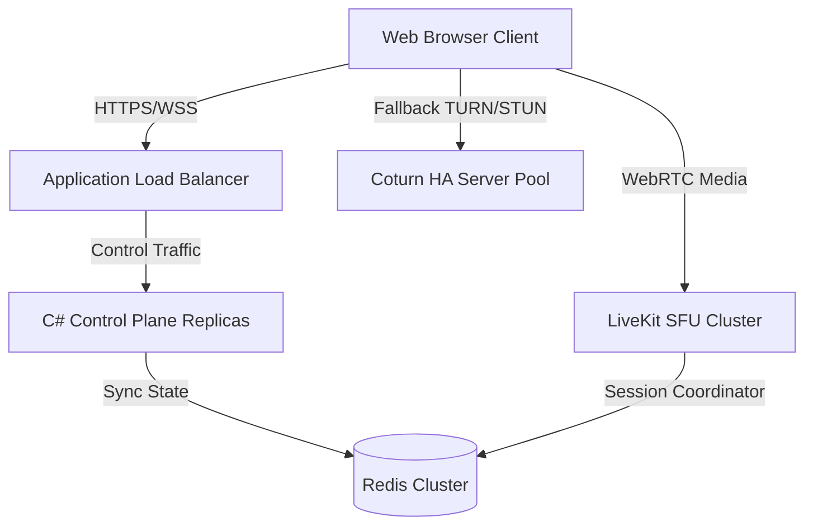

# Infrastructure & Code Improvements Guide (Upgrading to 9/10+)

To elevate this project from a local development/UAT state to a highly available, enterprise-ready 9/10+ system, the following architectural upgrades should be applied.

---

## 1. Database Tier: SQLite $\rightarrow$ Production Database
> [!IMPORTANT]
> The current C# control plane uses SQLite. While simple, SQLite is a file-based database. It prevents scaling the backend server container horizontally, as replicas cannot safely write to a shared SQLite file concurrently without corruption or locking.

*   **Action:** Migrate the EF Core database provider in [Program.cs](file:///C:/Users/kyawz/Desktop/project-k/backend-csharp/Program.cs#L46-L47) from SQLite to PostgreSQL or SQL Server.
*   **Infrastructure:** Run a managed DB service (such as GCP Cloud SQL or AWS RDS PostgreSQL) in a private VPC subnet.

---

## 2. Frontend Serving: Dev Server $\rightarrow$ Production Static Build
> [!WARNING]
> The `docker-compose.yaml` configuration runs Vite in `dev` mode under production-like environments. Dev servers consume high memory, expose source maps, and are not optimized for fast static delivery.

*   **Action:** Modify the [web/Dockerfile](file:///C:/Users/kyawz/Desktop/project-k/web/Dockerfile) to use a multi-stage build. 
    1. **Stage 1:** Install dependencies and run `npm run build` to output optimized static HTML, JS, and CSS files to a `/dist` directory.
    2. **Stage 2:** Copy these static files to a lightweight Nginx alpine image.
*   **Infrastructure:** Serve built assets directly through a Content Delivery Network (CDN) or a cloud storage bucket (e.g., Google Cloud Storage with Cloud CDN) to minimize load on your compute servers.

---

## 3. High-Availability WebRTC & TURN Topology
LiveKit SFUs and Coturn servers handle high-bandwidth real-time media and require specific scaling configurations.

*   **LiveKit Clustering:** Convert LiveKit from a standalone node to a clustered setup using Redis as the message bus. This allows LiveKit to automatically route participants in the same room to the same media server node while balancing different rooms across the cluster.
*   **TURN Server Pool:** Deploy multiple Coturn instances behind a Network Load Balancer (NLB) or distribute them geographically, configuring Coturn with dynamic authorization tokens synchronized with your control plane.

---

## 4. Resilient WebSocket Realtime Core
*   **Keep-Alives (Pings/Pongs):** Implement periodic ping-pong heartbeats inside [RoomEventHub.cs](file:///C:/Users/kyawz/Desktop/project-k/backend-csharp/Realtime/RoomEventHub.cs) to detect half-open TCP connections (where a client vanishes from the network without sending a close frame).
*   **Exponential Backoff Reconnection:** Enhance the frontend [useRoomEvents.ts](file:///C:/Users/kyawz/Desktop/project-k/web/src/api/useRoomEvents.ts#L58-L74) socket loop to use randomized exponential backoff instead of a fixed 1.2s delay to prevent "thundering herd" issues when the server restarts.

---

## 5. Security & Secret Management
*   **Production Secrets:** Avoid setting raw credentials in `docker-compose.yaml` environment variables. Transition to GCP Secret Manager or AWS Secrets Manager.
*   **JWT Algorithm Upgrade:** Upgrade token signatures from symmetric keys (HS256) to asymmetric keys (e.g., RS256/ES256). This allows third-party services to verify user tickets using a public key without exposing the private signing key.
