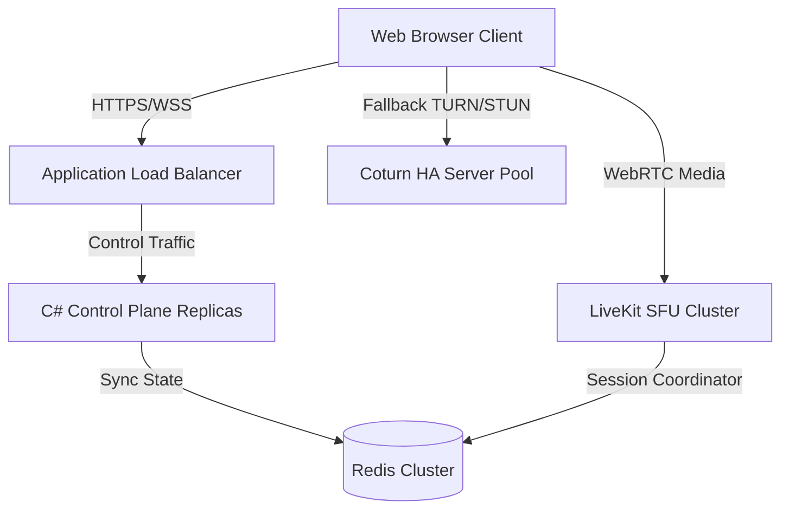

# Project-K: Enterprise Architecture & Production Roadmap

This consolidated roadmap outlines all codebase, network, and infrastructure upgrades required to elevate Project-K to a highly available, low-latency, global video conferencing platform capable of scaling to 10,000+ concurrent users.

---

## 1. Production Infrastructure & Database Scaling

### SQLite $\rightarrow$ PostgreSQL Migration
The current C# control plane uses SQLite. While simple, SQLite is a file-based database. It prevents scaling the backend server container horizontally, as replicas cannot safely write to a shared SQLite file concurrently without corruption or locking.
*   **Action:** Migrate the EF Core database provider in `Program.cs` from SQLite to PostgreSQL or SQL Server.
*   **Deployment:** Run a managed DB service (such as GCP Cloud SQL or AWS RDS PostgreSQL) in a private VPC subnet.

### Frontend Production Serving
The `docker-compose.yaml` configuration runs Vite in `dev` mode under production-like environments. Dev servers consume high memory, expose source maps, and are not optimized for fast static delivery.
*   **Action:** Modify the `web/Dockerfile` to use a multi-stage build.
    1.  **Stage 1:** Install dependencies and run `npm run build` to output optimized static HTML, JS, and CSS files to a `/dist` directory.
    2.  **Stage 2:** Copy these static files to a lightweight Nginx alpine image.
*   **Action:** In production, serve the built assets directly through a Content Delivery Network (CDN) or a cloud storage bucket (e.g., Google Cloud Storage with Cloud CDN) to minimize load on your compute servers.

### High-Availability WebRTC & TURN Topology
LiveKit SFUs and Coturn servers handle high-bandwidth real-time media and require specific scaling configurations.



*   **LiveKit Clustering:** Convert LiveKit from a standalone node to a clustered setup using Redis as the message bus. This allows LiveKit to automatically route participants in the same room to the same media server node while balancing different rooms across the cluster.
*   **TURN Server Pool:** Deploy multiple Coturn instances behind a Network Load Balancer (NLB) or distribute them geographically, configuring Coturn with dynamic authorization tokens synchronized with your control plane.

---

## 2. Global Kubernetes Deployment & Code Changes

To support a high-performance global conferencing network using Kubernetes, you cannot rely on static configuration files. The C# and React code must be updated to route traffic dynamically based on geography.

### C# Backend: Geo-Location Ingress Resolution
Currently, `RoomService.cs` uses a single static environment variable `LIVEKIT_PUBLIC_URL` for all users worldwide. If an Asian user joins a room hosted on a US server, they will experience extreme lag.
*   **Action:** Modify `RoomService.cs` to resolve the nearest regional LiveKit and TURN cluster based on the client's incoming IP address (using a GeoIP database or routing API):
    ```csharp
    private JoinTicketDto BuildTicket(RoomRecord room, ParticipantRecord participant, string mediaHost, string clientIp)
    {
        var regionalIngress = IngressRouter.GetClosestEndpoint(clientIp); 
        
        return new JoinTicketDto
        {
            Room = room,
            Participant = participant,
            LiveKitUrl = regionalIngress.LiveKitWsUrl, 
            LiveKitToken = _liveKit.CreateJoinToken(...),
            Turn = new TurnInfoDto
            {
                Urls = regionalIngress.TurnUrls,
                Username = username,
                Credential = credential
            }
        };
    }
    ```

### React Client: Enable Adaptive Streaming & Dynacast
To save bandwidth globally, you must configure the LiveKit client SDK to dynamically adapt quality settings based on network conditions.
*   **Action:** In `LiveKitConference.tsx` (or wherever the LiveKit `Room` object is instantiated), configure the connection options:
    ```typescript
    const room = new Room({
      adaptiveStream: true, // Enable LiveKit adaptive streaming (stops rendering offscreen video)
      dynacast: true, // Enable dynacast (stops uploading video resolution that nobody is watching)
      videoCaptureDefaults: {
        resolution: VideoPresets.h720.resolution,
      },
      publishDefaults: {
        videoSimulcast: true, // Send multiple resolutions (low, mid, high)
      }
    });
    ```

---

## 3. Codebase Quality & Logic Improvements

### Implement Webinar Mode Switch Logic
The dynamic scaling capability to handle 10,000+ webinar participants is currently stubbed out in `RoomModeService.cs`. The system always treats rooms as `Interactive`, bypassing the webinar-scale safety limits.
*   **Action:** Implement dynamic transitions based on configuration thresholds in `EvaluateMode`:
    ```csharp
    public string EvaluateMode(string currentMode, int totalParticipants, int publishers, int listeners)
    {
        if (currentMode == RoomModes.Interactive && totalParticipants >= _config.WebinarEnterListeners)
        {
            return RoomModes.Webinar;
        }
        if (currentMode == RoomModes.Webinar && totalParticipants <= _config.WebinarExitListeners)
        {
            return RoomModes.Interactive;
        }
        return currentMode;
    }

    public bool ShouldJoinAsListener(RoomRecord room, ParticipantRecord participant)
    {
        if (participant.Role is ParticipantRoles.Host or ParticipantRoles.CoHost)
            return false;

        return room.Mode == RoomModes.Webinar;
    }
    ```

### Eliminate Redundant Polling in React
In `RoomPage.tsx`, the frontend calls `listParticipants` API on every socket connection/disconnect event. 
*   **Action:** Rely on the LiveKit Client SDK's state synchronization rather than polling HTTP API endpoints for room rosters by listening to `RoomEvent.ParticipantConnected` and `RoomEvent.ParticipantDisconnected`.

### Dynamic TURN Credential Refreshing
*   **Action:** Provide an endpoint `/api/rooms/{roomId}/turn` to allow clients to request fresh TURN configurations on the fly before a token or TURN username expires (since credentials minted have a hard TTL).

---

## 4. World-Class Media Quality (Voice & Video Tuning)

To deliver high-fidelity voice and ultra-clear video conferencing comparable to the highest tiers of Zoom and Google Meet, configure the WebRTC media pipeline with the following codec profiles and processing features.

### High-Fidelity Audio Optimizations
*   **Opus RED (Redundant Audio Data):** Enable RED. This transmits redundant copies of audio packets. On lossy mobile networks or long-distance international routes with up to 20% packet loss, the client can recover the missing audio without gaps.
*   **AI Noise Suppression (RNNoise/WebAssembly):** Implement background noise cancellation using an AI model (like RNNoise or customized WebAssembly noise filters) on the client side before publishing the audio track.
*   **Bitrate & Stereo Configuration:** For standard speech, use 32kbps mono. For music or high-quality broadcasts (such as webinars), force the codec parameters to **64kbps or 128kbps stereo** with a 48kHz sampling rate.

### Advanced Video Codecs (AV1 & VP9 SVC)
Most basic WebRTC systems use the older H.264 codec. To get the best quality at the lowest bandwidth, upgrade to modern codecs.
*   **AV1 Codec:** AV1 offers **30% to 50% better compression than H.264**. It can deliver crystal-clear 1080p video at bandwidths where H.264 would pixelate or freeze.
*   **VP9 SVC (Scalable Video Coding):** If AV1 is not supported, fallback to VP9 with SVC. SVC embeds multiple resolutions and frame rates into a single stream. If a remote user's network degrades, the SFU instantly drops video frames or drops the resolution layer without needing to re-negotiate.

---

## 5. Lightweight API Connections & Communication Patterns

The communication design in this project is lightweight and follows WebRTC industry standards, but it must be kept optimal.

### Client $\leftrightarrow$ Control Plane
*   **WebSockets:** Used for real-time signaling, lock states, and chat events. WebSockets establish a single persistent TCP connection, removing HTTP header overhead for lightweight data transfer.
*   **Action:** Ensure your Kubernetes load balancers serve HTTP/2 or HTTP/3 to allow multiplexing of multiple API requests over a single connection.

### Control Plane $\leftrightarrow$ LiveKit Server
*   **REST Calls:** Kept to low-frequency setup actions (e.g. room creation, administrator participant expulsion).
*   **Action:** Use LiveKit Webhooks instead of C# polling. Set up webhook HTTP POST endpoints on your C# backend so that LiveKit notifies the backend automatically when participants join/leave the SFU, updating the Redis presence store instantly.
